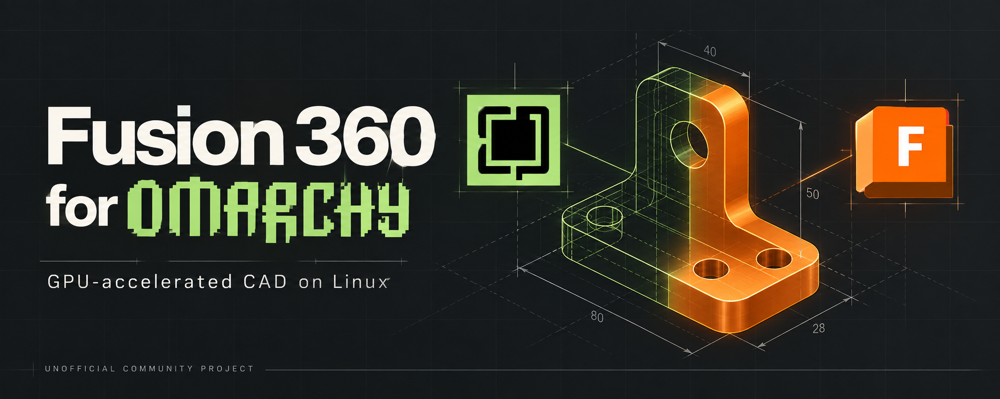

# Fusion 360 for Omarchy

**Run Autodesk Fusion on Omarchy Linux with GPU acceleration.**
This unofficial community project provides an installer, desktop launcher and Omarchy integration. Give this repository's link to your AI agent to install and verify it on your machine.



**Tested:** Fusion **2705.1.25** on **Omarchy 4.0.4-1**, with an AMD Radeon 8060S. The GE-Proton implementation passed independent hands-on review; the standalone Wine fallback is **unfinished**.

## Install with your agent

Copy this message to an agent that can access your Omarchy computer's terminal and desktop:

> Install Fusion 360 for Omarchy from https://github.com/keyclaw6/Fusion-360-for-Omarchy. Read README.md and INSTALL.md first. Use the default GE-Proton implementation, preserve my existing installations and designs, and let me complete Autodesk sign-in. Verify GPU rendering, modeling, saving/reopening and a cold restart before calling it working. Do not install the unfinished Wine experiment.

The agent downloads this repository, checks your system, builds the pinned compatibility fixes, installs Fusion from Autodesk, and helps verify the result. **You need your own Autodesk account and a valid Fusion entitlement.** Fusion itself is not included or relicensed.

[Agent installation guide](INSTALL.md) · [Download source ZIP](https://github.com/keyclaw6/Fusion-360-for-Omarchy/archive/refs/heads/main.zip)

Prefer to start manually?

```sh
git clone https://github.com/keyclaw6/Fusion-360-for-Omarchy.git
cd Fusion-360-for-Omarchy
# Read INSTALL.md and complete its host checks first.
python3 -B install.py
```

The first installation downloads and builds a substantial toolchain; it can take time and many gigabytes of storage. This is an agent-guided installation, with browser sign-in and verification, rather than a promise of unattended setup on every Linux machine.

## What you get

- **Fusion in the normal Omarchy desktop**, with a dedicated launcher and hardware-accelerated graphics.
- **Window integration** that keeps Fusion's Browser and Comments panels usable when switching applications or monitors.
- **Optional Fusion bar widget** for opening the application, checking status and viewing diagnostics.
- **Native Fusion MCP instructions** so a compatible agent can inspect and operate Fusion after you enable its local server.
- **Pinned build recipes, backups and recovery tools**, with application data kept outside the repository.

After installation, open **Fusion 360 for Omarchy** from the Apps menu, or run:

```sh
fusion360-for-omarchy launch
fusion360-for-omarchy status --json
```

## How it works

The default implementation runs the Windows version of Fusion through **GE-Proton 11-7**, started by **umu** inside **Steam Linux Runtime 4**. You do not need to sign into the Steam client. Fusion's DirectX 11 modeling graphics use **DXVK** on your Linux GPU; its Qt interface uses OpenGL.

The installer builds two narrowly patched Wine modules from pinned source and adds scoped Hyprland window integration. Fusion, its runtime, account state and designs live in a dedicated user directory, not in this source tree. [Installation and recovery details →](docs/install.md)

## Tested configuration

The recorded review was completed on **27 September 2026**:

| Component | Tested version |
| --- | --- |
| Autodesk Fusion | **2705.1.25** |
| Omarchy | **4.0.4-1** |
| Hyprland | **0.56.2** (package 0.56.2-2) |
| Linux kernel | **7.2.3-arch1-3** |
| GPU / graphics | **AMD Radeon 8060S**, Mesa/RADV **26.2.2** |
| Compatibility layer | **GE-Proton11-7-x86_64**, project overlay v3 |
| Launcher | **umu 1.4.4** |
| Steam Linux Runtime | **4.0.20260914.260627** |

These are tested versions, not a claim that every hardware/software combination works. Autodesk's downloader streams its current application build, so a new installation may receive a different Fusion version. Changed builds, drivers or desktop versions need fresh verification; checksum failures must not be bypassed.

The independent review passed sketches, grids, workplanes, extrusion/fillet/editing, identified face selection, cloud and local file round trips, navigation of a 64-occurrence assembly, monitor movement and three authenticated cold launches.

**Known limits:** File-menu Escape and Alt+F4 were inconsistent; click outside menus and use Omarchy's **Super+W** to close. CAM, simulation, suspend/resume and Windows/macOS frame-rate parity were not established. See the [acceptance summary](docs/acceptance.md) and [independent review](docs/operational-review.md).

## One repository, two implementations

| Location | Purpose | Status |
| --- | --- | --- |
| Repository root | GE-Proton installer, launcher, window integration, widget and MCP setup | **Default; accepted for the documented test scope** |
| [experimental/wine/](experimental/wine/README.md) | Standalone Wine 11.17 source, launcher and research, preserved if GE needs an alternative | **Unfinished; not installed or selected by the main installer** |

The Wine experiment is kept for future development. It is not an automatic failover, has no complete fresh-install workflow, and has not passed the full operational review. [Compare the approaches →](experimental/wine/docs/comparison.md)

## Guides and project notes

- [Install with an agent](INSTALL.md)
- [Install, update, back up and remove](docs/install.md)
- [Autodesk sign-in](docs/authentication.md)
- [Optional Omarchy widget](docs/plugin.md)
- [Connect an agent through Fusion MCP](docs/native-automation.md)
- [Testing and contributing](CONTRIBUTING.md)
- [Documentation index and experimental history](docs/README.md)

This is an **unofficial community integration**, not an Autodesk or Omarchy product, partnership or endorsement. The integration code is MIT-licensed; Wine patches and other upstream material retain their own licenses. Autodesk Fusion and all trademarks remain their owners' property. See [LICENSE](LICENSE), [third-party notices](THIRD_PARTY_NOTICES.md) and [artwork credits](assets/README.md).
